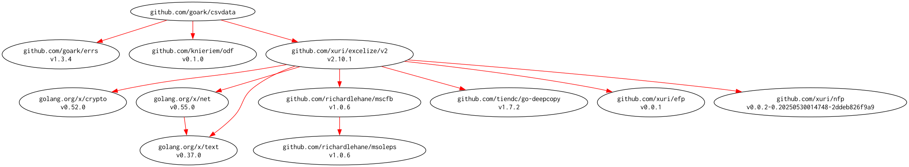

# [csvdata] -- Reading CSV Data

[](https://pkg.go.dev/github.com/goark/csvdata)
[](https://github.com/goark/csvdata/actions/workflows/ci.yml)
[](https://github.com/goark/csvdata/actions/workflows/codeql.yml)
[](https://raw.githubusercontent.com/goark/csvdata/master/LICENSE)
[](https://github.com/goark/csvdata/releases/latest)

This package is required Go 1.25 or later.

## Design Goals

- Provide a simple and stable interface for reading CSV-like rows.
- Keep parsing concerns separated by format adapters (`exceldata`, `calcdata`).
- Return explicit errors with context, and avoid hidden side effects.

## Development

### Local Validation

Primary command:

```text
task test
```

Equivalent direct commands:

```text
go mod verify
go test -shuffle on ./...
golangci-lint-v2 run --enable gosec --timeout 3m0s ./...
```

### Optional Checks

```text
task govulncheck
task graph
```

## CI Workflows

- `CI`: lint, tests, and vulnerability checks.
- `CodeQL`: security analysis.

All workflows are available in GitHub Actions for this repository.

## Usage

### Import

```go
import "github.com/goark/csvdata"
```

## Usage

```go
package csvdata_test

import (
	"fmt"

	"github.com/goark/csvdata"
)

func ExampleNew() {
	file, err := csvdata.OpenFile("testdata/sample.csv")
	if err != nil {
		fmt.Println(err)
		return
	}
	rc := csvdata.NewRows(csvdata.New(file), true)
	defer rc.Close()

	if err := rc.Next(); err != nil {
		fmt.Println(err)
		return
	}
	fmt.Println(rc.Column("name"))
	// Output:
	// Mercury
}
```

### Reading from Excel file

```go
package exceldata_test

import (
	"fmt"

	"github.com/goark/csvdata"
	"github.com/goark/csvdata/exceldata"
)

func ExampleNew() {
	xlsx, err := exceldata.OpenFile("testdata/sample.xlsx", "")
	if err != nil {
		fmt.Println(err)
		return
	}
	r, err := exceldata.New(xlsx, "")
	if err != nil {
		fmt.Println(err)
		return
	}
	rc := csvdata.NewRows(r, true)
	defer rc.Close() //dummy

	if err := rc.Next(); err != nil {
		fmt.Println(err)
		return
	}
	fmt.Println(rc.Column("name"))
	// Output:
	// Mercury
}
```

### Reading from LibreOffice Calc file

```go
package calcdata_test

import (
	"fmt"

	"github.com/goark/csvdata"
	"github.com/goark/csvdata/calcdata"
)

func ExampleNew() {
	ods, err := calcdata.OpenFile("testdata/sample.ods")
	if err != nil {
		fmt.Println(err)
		return
	}
	r, err := calcdata.New(ods, "")
	if err != nil {
		fmt.Println(err)
		return
	}
	rc := csvdata.NewRows(r, true)
	defer rc.Close() //dummy

	if err := rc.Next(); err != nil {
		fmt.Println(err)
		return
	}
	fmt.Println(rc.Column("name"))
	// Output:
	// Mercury
}
```

## Modules Requirement Graph

[](./dependency.png)

[csvdata]: https://github.com/goark/csvdata "goark/csvdata: Reading CSV Data"
